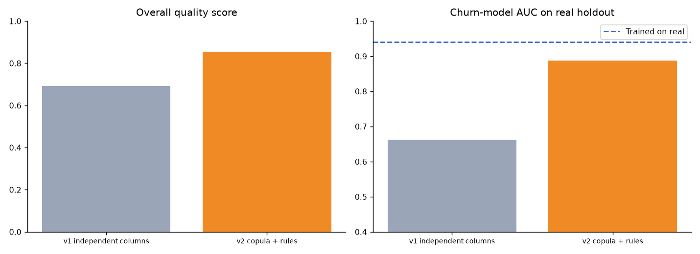
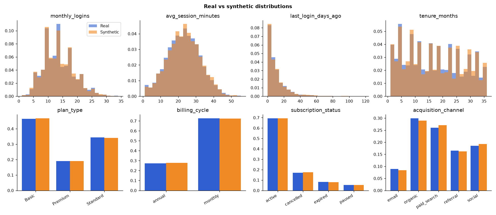
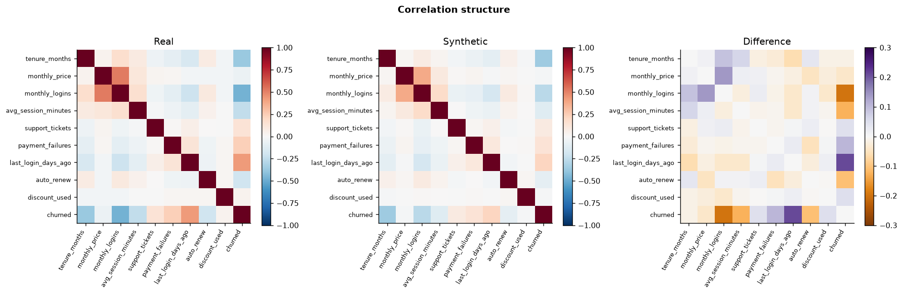
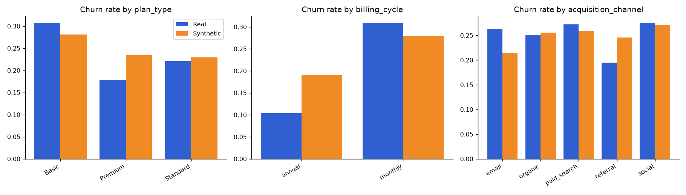

# Synthetic Subscription Churn Data Quality and Evaluation Report (Week 3)

*Generator:* `gaussian-copula (numpy/scipy fallback)`  |  *Source (train split):* 4,200 rows  |  *Synthetic:* 4,200 rows  |  *Held-out real data:* 1,800 rows

## 1. Method
The generator is fitted on a 70% train split of the source data. Evaluation compares synthetic data with that train
split, and uses the untouched 30% holdout only for the downstream churn-model test, so no model ever sees the holdout.

| Dimension | Test | Weight |
|---|---|---|
| Statistical similarity | 1 - KS statistic (numeric), 1 - total variation distance (categorical) | 30% |
| Relationship preservation | mean absolute difference of pairwise correlations (score = 1 - diff/0.10) | 15% |
| Validity | share of rows passing all 12 business rules | 15% |
| Churn-pattern preservation | churn-rate gap per plan / cycle / channel / country / auto-renew (score = 1 - gap/0.10) | 25% |
| Churn-model utility (TSTR) | AUC of a model trained on synthetic data, scored on real holdout, relative to a model trained on real data | 15% |

## 2. Results summary
| component | weight | v1 independent | v2 final |
|---|---|---|---|
| statistical_similarity | 0.300 | 0.985 | 0.989 |
| relationship_preservation | 0.150 | 0.006 | 0.582 |
| validity | 0.150 | 1.000 | 1.000 |
| churn_pattern | 0.250 | 0.561 | 0.719 |
| churn_model_utility | 0.150 | 0.704 | 0.944 |
| OVERALL (weighted) | 1.000 | 0.692 | 0.855 |

Churn-model AUC on real holdout - trained on **real**: 0.941; trained on **synthetic v1**: 0.662;
trained on **synthetic v2 (final)**: 0.888.

## 3. Statistical similarity
| numeric column | similarity (1-KS) |
|---|---|
| tenure_months | 0.979 |
| monthly_price | 0.977 |
| monthly_logins | 0.986 |
| avg_session_minutes | 0.981 |
| support_tickets | 0.991 |
| payment_failures | 0.998 |
| last_login_days_ago | 0.992 |

| categorical column | similarity (1-TVD) |
|---|---|
| plan_type | 0.997 |
| billing_cycle | 0.996 |
| country | 0.989 |
| acquisition_channel | 0.982 |
| auto_renew | 0.985 |
| discount_used | 0.995 |
| subscription_status | 0.995 |

Weakest numeric column: `monthly_price` (0.977); weakest categorical column: `acquisition_channel` (0.982).

## 4. Relationship preservation
Mean absolute correlation difference: **0.042** (v1: 0.099).

## 5. Validity (business rules)
|  | rule | pass rate |
|---|---|---|
| unique_customer_id | customer_id is unique | 100.0% |
| signup_in_range | signup_date lies within the allowed signup window | 100.0% |
| price_matches_plan | monthly_price equals the list price for plan_type and billing_cycle | 100.0% |
| valid_status | subscription_status is one of active/paused/cancelled/expired | 100.0% |
| churn_flag_consistent | churned == 1 exactly when status is cancelled or expired | 100.0% |
| tenure_within_lifetime | 0 <= tenure_months <= months between signup and snapshot | 100.0% |
| active_tenure_full_lifetime | non-churned customers have tenure equal to their full lifetime | 100.0% |
| churned_tenure_positive | churned customers have tenure_months >= 1 | 100.0% |
| churn_date_consistent | churn_date present only for churned customers and between signup and snapshot | 100.0% |
| non_negative_counts | logins, tickets, payment failures and last_login_days_ago are >= 0 | 100.0% |
| session_minutes_range | avg_session_minutes is within 1..90 | 100.0% |
| binary_flags_valid | auto_renew, discount_used and churned are 0/1 | 100.0% |

## 6. Churn-pattern preservation
Churn rate: real **25.3%** vs synthetic **25.5%**.
Mean absolute churn-rate gap across segments: **0.028**.

| feature (churned / active mean) | real_churned_vs_active_ratio | synthetic_churned_vs_active_ratio |
|---|---|---|
| monthly_logins | 0.623 | 0.774 |
| support_tickets | 1.313 | 1.205 |
| payment_failures | 2.382 | 1.668 |
| last_login_days_ago | 2.647 | 1.699 |

## 7. Privacy / copy check
Exact copies of source records (all columns except the id): **0.00%** - passed.

## 8. Issues identified and refinement activities
| # | Issue found in v1 (independent column sampling) | Refinement applied in v2 | Effect |
|---|---|---|---|
| 1 | Column relationships lost: correlation gap 0.099, so churn drivers (logins, tickets, payment failures) no longer predict churn | Gaussian copula learns the joint dependence between all columns | gap 0.099 -> 0.042 |
| 2 | Churn model trained on v1 data generalises poorly (AUC 0.662 vs 0.941 on real) | Same copula fix | AUC 0.662 -> 0.888 |
| 3 | Categorical columns are treated as *ordered* by a copula, which breaks category-churn dependence (e.g. `paused` sits between `active` and `cancelled` alphabetically) | Categories ordered by observed churn rate before encoding | stronger churn-pattern and relationship scores |
| 4 | Derived fields could contradict each other (price vs plan, churn flag vs status, tenure vs signup date) | Price, churn flag, tenure bounds, churn date and ids are rebuilt from business rules, never sampled | validity 100% |
| 5 | Tenure of active customers is fully determined by signup date and distorts the learned tenure distribution | Tenure modelled as a ratio of possible lifetime, learned from churned customers only | tenure similarity 0.979 |
| 6 | Need to test models at other churn rates | Conditional (rejection) sampling on the churn label to hit an exact requested rate | `target_churn_rate` API parameter |

**Remaining limitations:** the relationship score is the weakest dimension (a Gaussian copula captures monotonic,
pairwise dependence, not complex interactions); correlations involving discrete columns are slightly attenuated; and the
source data is itself a simulated approximation of real subscription behaviour, so conclusions drawn from the synthetic
data are only as good as that sample.

## 9. Conclusion
Overall quality score **0.855** (v1: 0.692).
The final generator produces rule-consistent records that preserve distributions and churn patterns well enough to
exercise churn-prediction pipelines, with no copied records.
